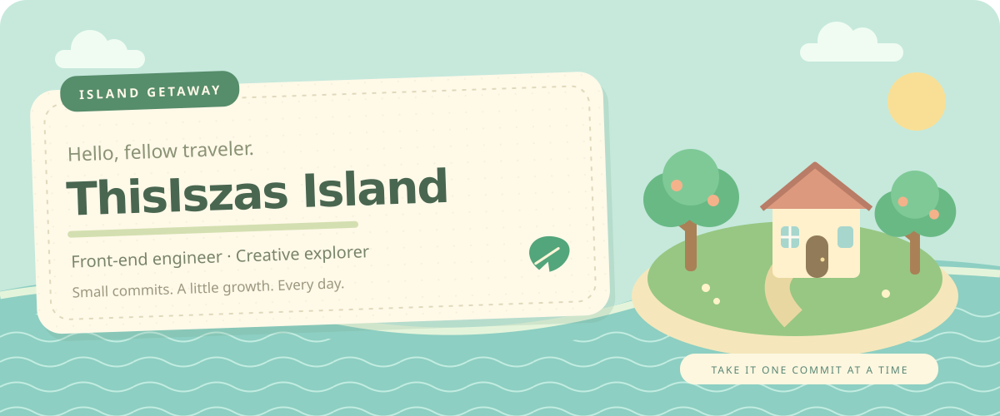
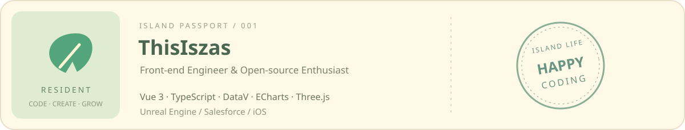
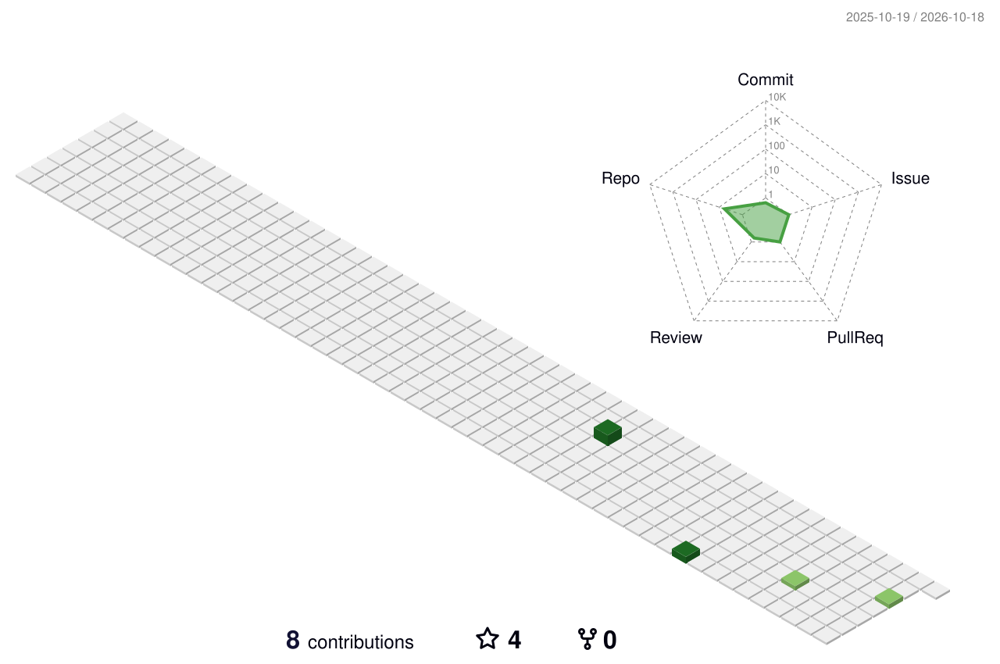

<!-- Custom island artwork lives in assets/. Keep relative image paths for GitHub profile rendering. -->

  

  <b>🍃 欢迎来到我的代码小岛</b> 
  写一点代码，种一点灵感，把想法慢慢建成喜欢的样子。

  <a href="#-口袋工具箱">口袋工具箱</a> ·
  <a href="#-岛上工坊">岛上工坊</a> ·
  <a href="#-种树日记">种树日记</a> ·
  <a href="#-来小岛串门">来小岛串门</a>

### 🛠️ 口袋工具箱

> 从一个组件到一整座数字世界，工具箱里的每件小工具都有用武之地。

  

  
  
  
  

| 小岛区域 | 正在建造的世界 |
| :--- | :--- |
| 🌱 前端花园 | Vue 3 · TypeScript · 中后台系统 |
| 🏝️ 可视化广场 | DataV · ECharts · Three.js · 数据大屏 |
| 🏭 数字工坊 | 工业智造前端 · 设备管理 · 生产看板 · UE 可视化 |
| ✈️ 远行码头 | Salesforce · iOS · Swift · Objective-C |

### 🏡 岛上工坊

#### 📦 大屏屏幕适配库 · `@thisiszas/bigscreen-board`

把固定设计稿等比投影到不同分辨率的屏幕，让每块数据大屏都找到合适的尺寸。

- **两种适配方式**：等比缩放（scale） / 拉伸（stretch）。
- **背景自然延展**：支持 cover 自适应。
- **轻装上岛**：零依赖，仅 peer 依赖 Vue，不捆绑 ECharts 或字体。

  
  
  

### 🌳 种树日记

> 每一次提交，都是小岛长出的一片新叶子。

  

  

📒 打开岛民记录册 · GitHub 统计与成就

 

  
  

  

  

🐍 草地里的小访客 · 贡献动画

 

  

### 💌 来小岛串门

想聊前端、数据可视化，或者分享一个有趣的想法？欢迎来串门。

  
  
  

  

